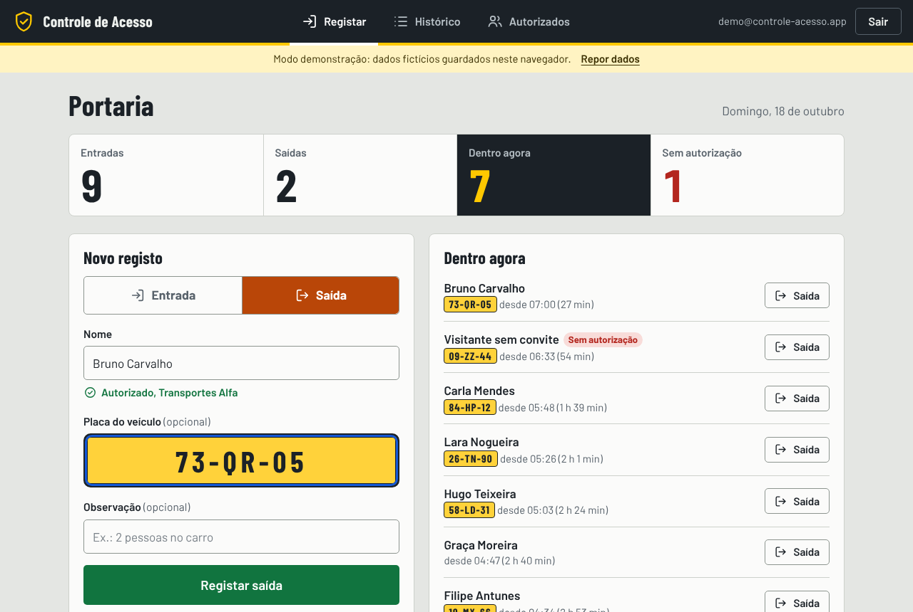
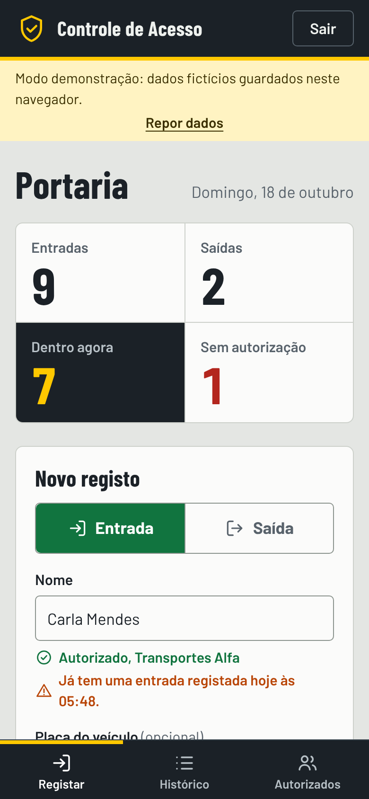
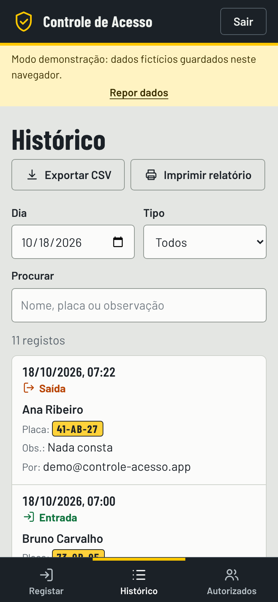
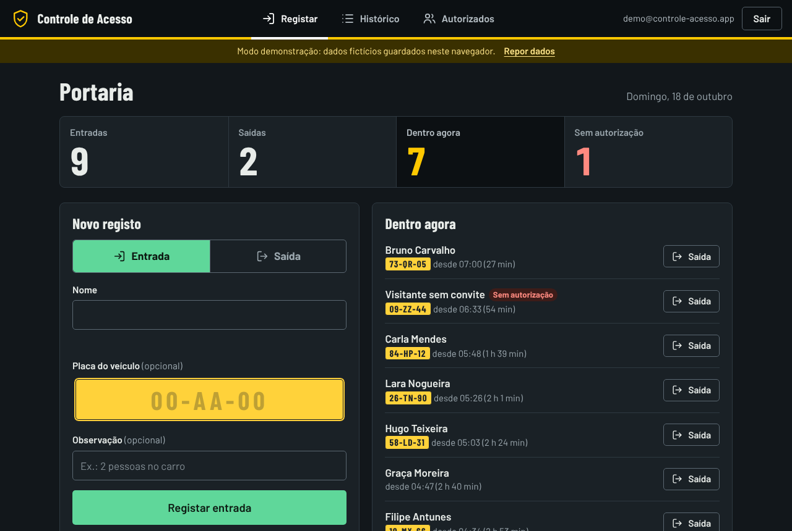

# Controle de Acesso Digital

Aplicação web (PWA) para registar as **entradas e saídas de pessoas e veículos** numa portaria industrial ou corporativa: quem entrou, a que horas, com que veículo, se estava autorizado e quem ainda se encontra dentro.


<p align="center">
  
</p>

<p align="center">
  
  &nbsp;
  
  &nbsp;
  
</p>

## Sobre esta versão

Este foi o meu primeiro projeto. A versão 1 nasceu de uma necessidade real de trabalho e cumpriu a sua função, mas tinha as falhas de quem está a aprender: tudo em dois ficheiros HTML, código repetido, `alert()` para tudo, uma chave de backend no código e um registo de contas aberto a qualquer pessoa.

A **versão 2.0** é uma reescrita completa, feita para mostrar como hoje estruturo, protejo e testo uma aplicação. O endereço público original pertence a outra entidade, por isso esta versão corre sozinha, em modo demonstração, sem depender de nenhum servidor.

Os nomes, empresas e placas que aparecem são todos fictícios.

## Funcionalidades

- **Registo de entrada e saída** com nome, placa e observação, num formulário pensado para uso rápido no telemóvel.
- **Verificação de autorização** enquanto se escreve o nome (ignora acentos e maiúsculas) e confirmação antes de registar alguém que não consta na lista.
- **Avisos de incoerência**: entrada repetida, ou saída de quem não tem entrada nesse dia.
- **Quadro do dia**: entradas, saídas, quem está dentro agora e movimentos sem autorização.
- **Dentro agora**, com atalho para registar a saída com um toque.
- **Histórico** com filtro por dia, tipo e pesquisa livre.
- **Exportação para CSV** (compatível com Excel em português) e **relatório para impressão ou PDF**, com espaço para visto do vigilante.
- **Gestão da lista de autorizados**: adicionar, remover e importar por ficheiro JSON.
- **PWA**: instalável no telemóvel e a abrir sem rede.
- **Tema claro e escuro** automáticos, com navegação por teclado e leitores de ecrã em mente.

## Experimente

Não precisa de instalar nada além de um servidor estático (os módulos JavaScript não funcionam a partir de `file://`).

```bash
git clone <endereço-deste-repositório>
cd controle-acesso-digital
npm start            # ou: python3 -m http.server 8080
```

Abra `http://localhost:8080`. No ecrã de login, escolha **Preencher com a conta de demonstração**:

| Campo  | Valor                         |
| ------ | ----------------------------- |
| E-mail | `demo@controle-acesso.app`    |
| Senha  | `demo1234`                    |

No modo demonstração os dados ficam apenas no `localStorage` do seu navegador. A opção **Repor dados** na faixa amarela volta ao conjunto fictício inicial.

> O login do modo demonstração serve para mostrar o fluxo, não é segurança. A autenticação real só existe no modo Firebase.

## Como está organizado

```
index.html              Estrutura da página única (login, registar, histórico, autorizados)
css/app.css             Estilos, tokens de cor e tema escuro
js/
  app.js                Ligação entre a interface e os dados
  config.js             Modo (demo ou firebase) e configuração
  lib/                  Lógica pura, sem DOM e com testes
    text.js               normalização de nomes, validação e formatação de placas
    stats.js              quem está dentro, resumo do dia, último registo
    csv.js                exportação segura para CSV
    format.js             datas e horas
  store/                Camada de dados com o mesmo contrato para os dois modos
    local.js              demonstração (localStorage)
    firebase.js           Firebase Auth + Cloud Firestore
    seed.js               dados fictícios
  ui/                   Pequenos módulos de interface (DOM, avisos, diálogo)
data/autorizados.json   Lista inicial de pessoas autorizadas (fictícia)
sw.js                   Service worker (cache do shell e modo offline)
manifest.webmanifest    Manifesto da PWA
firestore.rules         Regras de segurança de exemplo
tests/                  Testes unitários (node:test)
```

A decisão central é a **camada `store/`**: a interface fala com um contrato (`login`, `subscribeRegistos`, `addRegisto`, ...) e não sabe se por trás está o `localStorage` ou o Firestore. Trocar de modo é mudar uma linha em `js/config.js`.

## Usar com Firebase

1. Crie um projeto no [Firebase](https://console.firebase.google.com), ative **Authentication** (e-mail e senha) e **Cloud Firestore**.
2. Crie os utilizadores manualmente na consola. A aplicação não tem registo público, de propósito.
3. Copie as credenciais da app web para `js/config.js` e mude `mode` para `"firebase"`.
4. Publique as regras de `firestore.rules`. Os registos passam a ser só de acréscimo: ninguém os edita nem apaga, o que preserva a rastreabilidade.
5. Na consola Google Cloud, restrinja a chave de API ao seu domínio.

O SDK só é carregado neste modo. A cache persistente do Firestore permite registar sem rede e sincronizar depois.

## Testes

```bash
npm test
```

Cobrem a lógica que mais importa: normalização de nomes, validação de placas, cálculo de quem está dentro e a exportação CSV (incluindo proteção contra injeção de fórmulas).

## O que mudou da v1 para a v2

| Versão 1 | Versão 2 |
| --- | --- |
| Chave e identificadores do Firebase no código | Sem credenciais no repositório; configuração à parte |
| Qualquer pessoa podia criar conta | Sem registo público; contas criadas por quem administra |
| Duas páginas com código duplicado (entrada e saída iguais) | Módulos pequenos, uma função de registo, lógica testada |
| `alert()`, `prompt()` e `confirm()` | Avisos, diálogos acessíveis e erros junto dos campos |
| Nome comparado em texto exato (`João` ≠ `joao`) | Comparação sem acentos nem maiúsculas |
| Aceitava saída sem entrada e entrada repetida | Avisa antes de registar |
| Placa em texto livre | Validada e formatada |
| PDF com texto corrido, apenas do dia | CSV e relatório imprimível com filtros |
| Service worker falhava a instalar (listava ícones que não existiam) | Só pré-carrega ficheiros reais; rede primeiro para HTML e dados |
| Dependência de CDNs (Font Awesome, Google Fonts, jsPDF) | Fontes e ícones incluídos: funciona offline e sem pedidos a terceiros |
| Sem teste algum | Testes unitários da lógica |
| Layout genérico de formulário | Interface própria, responsiva, com tema escuro |

## Limitações conhecidas

- O modo demonstração não tem autenticação real nem partilha dados entre dispositivos.
- A hora de cada registo vem do relógio do dispositivo (para funcionar offline). O servidor guarda também a sua própria hora, em `criadoEm`, para auditoria.
- O histórico carrega os últimos 30 dias no modo Firebase.
- O modo Firebase foi escrito segundo a documentação do SDK 10.12, mas não foi testado contra um projeto real nesta versão.

## Autor

**Pablo Monteiro** · [GitHub](https://github.com/PabloMonteiro92) · [Portfólio](https://pablomonteiro92.github.io/pablo-monteiro-developer/)

Projeto de portfólio, em transição para cibersegurança (SOC, AppSec e Blue Team). Esta aplicação reflete esse caminho: autenticação sem registo aberto, regras de acesso mínimas, registos imutáveis, validação de entradas e exportação protegida.

## Licença

[MIT](LICENSE)
